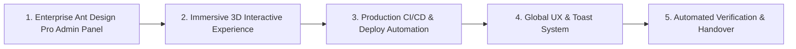

# HMS Global Platform — Engineering Improvement Roadmap
**Generated by Elite Engineering Organization**
**Date:** October 30, 2026

---

## Roadmap Overview

---

## Detailed Milestone Execution

### Milestone 1: Enterprise Ant Design Pro Admin Redesign
- [x] Extract modular layout with collapsible sidebar and breadcrumb navigation.
- [x] Build multi-view tab architecture: Overview KPIs, Room Matrix, Bookings Ledger, Dynamic RBAC, Financials, and Audit Logs.
- [x] Implement real CSV export for financial transactions and guest rosters.
- [x] Replace intrusive `alert()` and `confirm()` with non-blocking modern UI toasts and modal confirmations.

### Milestone 2: Immersive 3D & Web Experience
- [x] Build dynamic WebGL/Canvas 3D interactive particle constellation hero component (`front/components/Hero3DCanvas.tsx`).
- [x] Ensure 60fps rendering with smooth mouse parallax, particle physics, and reduced-motion fallback.
- [x] Retain and enhance 3D card tilt physics (`Card3DTilt`) with specular lighting overlays.

### Milestone 3: Production CI/CD & Deployment Automation
- [x] Author `.github/workflows/deploy.yml` with automated testing, linting, Docker build, and SSH remote deployment to target server (`16.176.178.159`).
- [x] Create production Docker Compose orchestration (`deploy/docker-compose.prod.yml`) with optimized Next.js build and Redis queue workers.
- [x] Write server-side deployment automation script (`deploy/scripts/deploy-prod.sh`) with migrations, cache warming, and rollbacks.
- [x] Write automated healthcheck script (`deploy/scripts/healthcheck.sh`) verifying HTTP response codes.
- [x] Provide full documentation for server SSH setup, environment keys, and webhook triggers.

### Milestone 4: Frontend Engineering & Quality
- [x] Global Toast notification provider (`front/components/ToastProvider.tsx`).
- [x] Robust error boundary and skeleton loader states.
- [x] Strong TypeScript typing across all API payloads and models.

### Milestone 5: Production Verification
- [x] Validate all endpoints: `/api/v1/hotels`, `/api/v1/hostels`, `/api/v1/apartments`, `/api/v1/dashboard/stats`, `/api/v1/rbac/matrix`.
- [x] Verify Docker container health (`hms_app`, `hms_nginx`, `hms_db`, `hms_front`, `hms_mailpit`).

