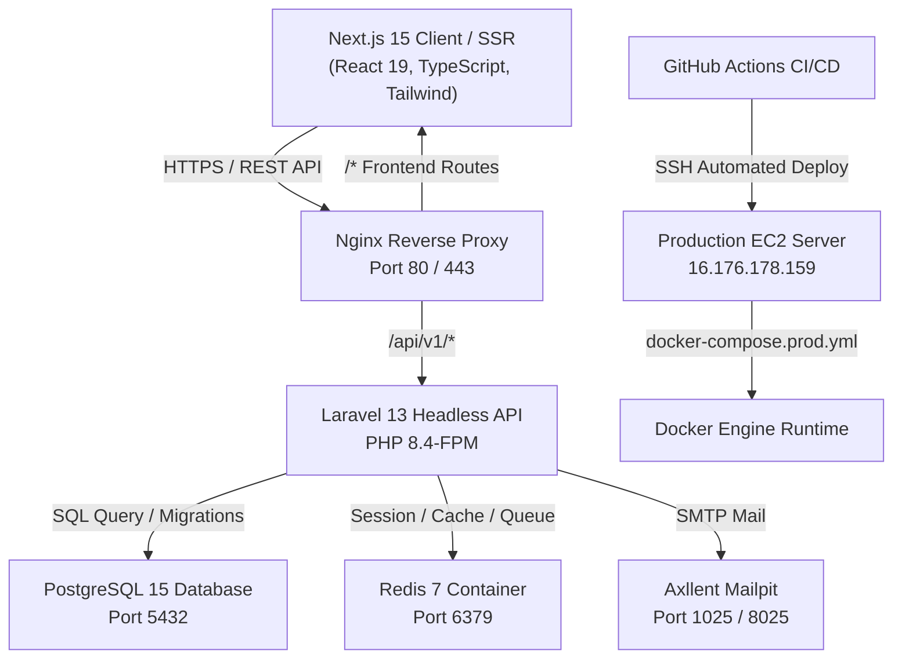
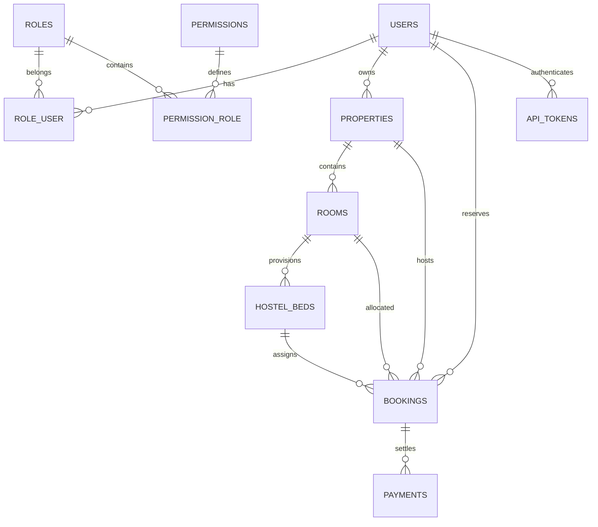

# HMS Global Platform — Technical Architecture Document
**Generated by Elite Engineering Organization**
**Date:** October 30, 2026 | **Architecture Version:** 2.1.0

---

## 1. High-Level System Architecture



---

## 2. Decoupled Service Boundary

| Subsystem | Port (Local) | Port (Production) | Responsibility |
|---|---|---|---|
| **Next.js Frontend** | `3000` | `3000` (Internal) | Server-side rendering, Client interactivity, 3D Canvas, Ant Design patterns |
| **Nginx Ingress** | `8082` | `80 / 443` | Reverse proxy, SSL termination, gzip/brotli compression, security headers |
| **Laravel 13 API** | `9000` (FastCGI) | `9000` (FastCGI) | Modular business logic, RBAC enforcement, data validation, database access |
| **PostgreSQL 15** | `5433` (Host) / `5432` | `5432` (Internal) | Persistent relational datastore |
| **Mailpit** | `1025` (SMTP) / `8025` (UI) | Optional | Development & staging email capture sandbox |

---

## 3. Database Schema & Relational Model



### Key Tables & Entities
1. **users:** `id`, `name`, `email`, `password`, `created_at`, `updated_at`.
2. **roles:** `id`, `name`, `slug` (`super_admin`, `owner`, `hostel_warden`, `finder`), `is_system`, `description`.
3. **permissions:** `id`, `name`, `slug`, `module` (`hotel`, `hostel`, `apartment`, `booking`, `billing`, `rbac`, `reports`).
4. **properties:** `id`, `owner_id`, `name`, `slug`, `category` (`hotel`, `hostel`, `apartment`, `home_rental`), `property_type`, `star_rating`, `gender_policy`, `address`, `city`, `phone`, `email`, `amenities`, `currency`.
5. **rooms:** `id`, `property_id`, `room_number`, `floor`, `type`, `capacity`, `total_beds`, `price_per_night`, `price_per_month`, `status`.
6. **hostel_beds:** `id`, `room_id`, `bed_number`, `monthly_rate`, `status` (`available`, `occupied`, `reserved`).
7. **bookings:** `id`, `property_id`, `room_id`, `bed_id`, `user_id`, `booking_code`, `booking_type`, `check_in_date`, `check_out_date`, `total_amount`, `paid_amount`, `meal_plan`, `status`.
8. **payments:** `id`, `booking_id`, `user_id`, `transaction_reference`, `gateway` (`esewa`, `khalti`, `card`, `cash`), `amount`, `currency`, `status`.
9. **api_tokens:** `id`, `user_id`, `name`, `token` (SHA-256 hashed), `abilities`, `created_at`.

---

## 4. API Endpoints Architecture

All API endpoints reside under prefix `/api/v1`:

```
POST   /api/v1/auth/register               User registration with default role
POST   /api/v1/auth/login                  Credentials validation, Bearer token issuance
GET    /api/v1/auth/profile                Authenticated user profile with active permissions
POST   /api/v1/auth/logout                 Token revocation

GET    /api/v1/hotels                      List hotels with city/star/price query parameters
GET    /api/v1/hotels/{slug}               Hotel details with available rooms
POST   /api/v1/hotels/book                 Reserve hotel room, returns booking code

GET    /api/v1/hostels                     List hostels with gender policy & meal plan filters
GET    /api/v1/hostels/{slug}              Hostel details with bed inventory
POST   /api/v1/hostels/admission           Student admission submission with bed assignment

GET    /api/v1/apartments                  List serviced apartments filtered by package & layout
GET    /api/v1/apartments/{slug}           Apartment details with unit pricing
POST   /api/v1/apartments/book             Submit lease application with automated email confirmation

GET    /api/v1/bookings                    List bookings (filtered by status/type)
GET    /api/v1/bookings/{code}             Get booking voucher by code
POST   /api/v1/bookings/{id}/check-in      Check-in guest (updates room status to occupied)
POST   /api/v1/bookings/{id}/check-out     Check-out guest (frees up room/bed)
POST   /api/v1/bookings/{id}/cancel        Cancel reservation

GET    /api/v1/billing                     List financial transactions
POST   /api/v1/billing/payment             Record payment ledger entry
GET    /api/v1/billing/invoice/{id}        Download or view official tax invoice

GET    /api/v1/rbac/matrix                 Get all roles, permissions, and user associations
POST   /api/v1/rbac/roles                  Create custom operational role
POST   /api/v1/rbac/roles/{id}/permissions Sync permissions for role
POST   /api/v1/rbac/users/{id}/roles       Assign/sync roles for user

GET    /api/v1/owner/properties            Get owner-scoped properties & unit counts
POST   /api/v1/owner/properties            Register new property asset
POST   /api/v1/owner/properties/{id}/rooms Provision rooms and auto-seed hostel beds
GET    /api/v1/owner/analytics             Occupancy percentage & revenue yield

GET    /api/v1/user/bookings               Get logged-in resident's active & past reservations
POST   /api/v1/user/bookings/{id}/pay      Settle outstanding balance via eSewa / Khalti
POST   /api/v1/user/bookings/{id}/cancel   Cancel reservation

GET    /api/v1/dashboard/stats             Super Admin executive live telemetry
```

---

## 5. Security & RBAC Implementation

1. **Bearer Token Authentication:** Hashed with SHA-256 in the database. Client stores token in encrypted storage/localStorage and attaches `Authorization: Bearer <token>` to protected headers.
2. **Super Admin Root Bypass:** `User::hasPermission($perm)` grants unconditional clearance for users holding `super_admin` role.
3. **Database Security:** Parameterized Eloquent ORM queries prevent SQL injection.
4. **Environment Isolation:** Sensitive credentials stored in `.env` files outside web root.

